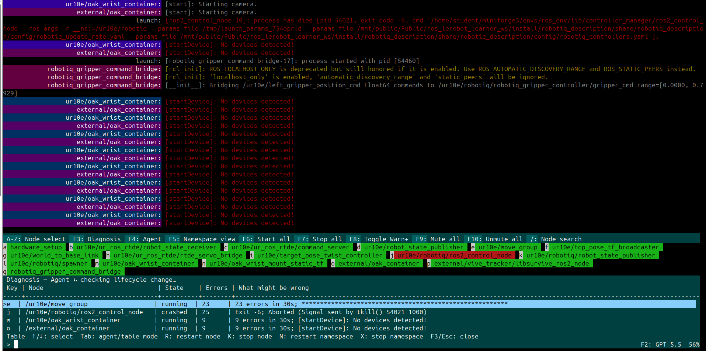
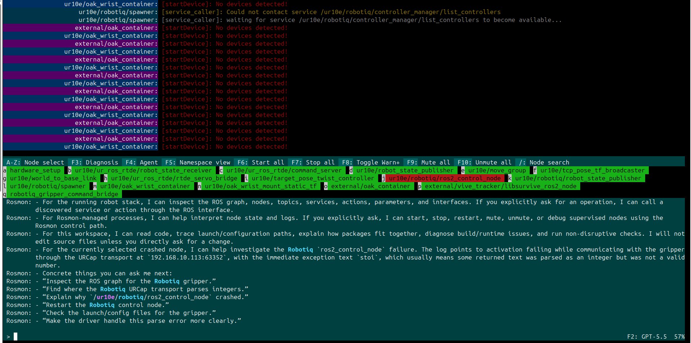

# rosmon2 · Robotnik fork

**A node launcher and monitor for ROS 2 Jazzy, in the style of [rosmon](https://github.com/xqms/rosmon) (ROS 1).**
Every node with its state in color, and stop, start, restart and mute nodes from the keyboard or from a ROS 2 service.


## What you get

- Launches **any launch file** (`.launch.py`, XML, YAML) with the native `ros2 launch` engine: **no launch file, node or parameter has to change**.
- One node per line, **colored by state**, with keys to act on it.
- Control from ROS 2 (`ros2 service call ...`), like in rosmon 1.
- Plugs into `bringup.sh` with one variable and one function: any group can move to rosmon2, or back to `ros2 launch`, by editing a list.
- No external Python dependencies, and no internet access needed on the robot.

<details>
<summary><b>What differs from the original rosmon2</b></summary>

The fork branched from commit `578ea91` (2026-07-24) and later merged the upstream Agent and Diagnosis panels (`F2`/`F3`/`F4`, optional, see below). On top of upstream it adds:

| Change | Why |
| --- | --- |
| MCP server (`rosmon2-mcp`) removed | Not needed in a bringup, and it avoids an external control path |
| Adaptive colors (24-bit, 256 or 16 colors) | Inside `screen` 4.x, the one shipped by Ubuntu, the original showed everything in gray |
| `--strip-prefix` | Hides the `/robot/` prefix, only in the text of the screen |
| ROS 2 interface (`--ros`) and the `rosmon2_msgs` package | A `start_stop` service and a `state` topic, like `rosmon_msgs` in ROS 1 |

</details>

## Packages

| Repository | Package | What it is |
| --- | --- | --- |
| [`rosmon2`](https://github.com/RobotnikAutomation/rosmon2) | `rosmon2` (`ament_python`) | The monitor: the `mon2` and `rosmon2` commands |
| [`rosmon2_msgs`](https://github.com/RobotnikAutomation/rosmon2_msgs) | `rosmon2_msgs` (`ament_cmake`) | The `StartStop` service and the `State` message |

Install **both, as sibling folders** in the `src/` of your workspace.

## Installation

Tested on **Ubuntu 24.04 · ROS 2 Jazzy · GNU screen 4.09**. No `pip` and no internet access are needed on the robot.

```bash
# 1. Requirements (rosidl_default_generators usually comes with ROS)
sudo apt install screen python3-colcon-common-extensions ros-jazzy-rosidl-default-generators

# 2. Clone next to your packages
cd ~/robot_ws/src
git clone https://github.com/RobotnikAutomation/rosmon2.git
git clone https://github.com/RobotnikAutomation/rosmon2_msgs.git

# 3. Build only these two packages (the rest of the workspace is not touched)
cd ~/robot_ws
source /opt/ros/jazzy/setup.bash
colcon build --symlink-install --packages-select rosmon2_msgs rosmon2
source install/setup.bash

# 4. Check
mon2 --help
ros2 interface show rosmon2_msgs/srv/StartStop
```

**The environment that runs `bringup.sh` must load this workspace.** In the reference bringup `ros_config.sh` already does; check with `source ~/ros_config.sh && command -v mon2`, which must print a path. Without `rosmon2_msgs` in that environment the groups still start, but without the service and the topic.

## Configure the bringup

Two files change, and no launch file is modified. Back both up first:

```bash
cp ~/bringup.sh ~/bringup.sh.bak
cp ~/robot_settings/robot_params/bringup.env ~/robot_settings/robot_params/bringup.env.bak
```

> `configure_bringup.sh` **overwrites** `~/bringup.sh` and `~/ros_config.sh` with the ones in `robot_packages`. For these changes to survive, also apply them to `scripts/bringup.sh` and `settings/robot_params/bringup.env` in that repo.

### 1. `bringup.env`: which groups use rosmon2

In `~/robot_settings/robot_params/bringup.env`, next to the `ROBOT_RUN_*` variables, add:

```bash
export ROBOT_ROSMON2_GROUPS="base devices localization perception navigation manipulation behavior hmi"
```

The groups in the list are launched with rosmon2; the others with `ros2 launch`, as always. Use a subset (`"hmi perception"`) to start with fewer, or `""` to turn it all off.

> All the groups of the reference bringup have been tested with rosmon2. If your bringup differs, add groups one by one and **leave `base` (motors) for last**.

### 2. `bringup.sh`: one function, and replace the group lines

**1)** Paste this function **before the first time a group is launched**: in the reference bringup, right before `if $ROBOT_RUN_SIMULATION` (after the `zenoh_router` and `discovery_server` blocks). It uses `echo_warning`, which `bringup.sh` already defines.

```bash
function launch_group() {
  local group="$1" launch_file="$2"
  local robot_id="${ROBOT_ID:-robot}"
  if [[ " $ROBOT_ROSMON2_GROUPS " == *" $group "* ]]; then
    if command -v mon2 > /dev/null 2>&1; then
      screen -S $group -d -m mon2 launch --session $group --strip-prefix $robot_id --ros --ros-namespace $robot_id $ROBOT_BRINGUP_PACKAGE $launch_file
      return
    fi
    echo_warning "--> $group: mon2 (rosmon2) not found, launching it with ros2 launch"
  fi
  screen -S $group -d -m ros2 launch $ROBOT_BRINGUP_PACKAGE $launch_file
}
```

**2)** Replace every `screen -S <group> ... ros2 launch ...` line with a call to the function (`grep -n "screen -S" ~/bringup.sh` finds them). The rest of each block (`echo_success`, `sleep`) does not change:

```diff
-  screen -S base -d -m ros2 launch $ROBOT_BRINGUP_PACKAGE $ROBOT_BRINGUP_LAUNCH;
+  launch_group base $ROBOT_BRINGUP_LAUNCH
-  screen -S devices -d -m ros2 launch $ROBOT_BRINGUP_PACKAGE devices_complete.launch.py;
+  launch_group devices devices_complete.launch.py
-  screen -S localization -d -m ros2 launch $ROBOT_BRINGUP_PACKAGE localization_complete.launch.py;
+  launch_group localization localization_complete.launch.py
-  screen -S perception -d -m ros2 launch $ROBOT_BRINGUP_PACKAGE perception_complete.launch.py;
+  launch_group perception perception_complete.launch.py
-  screen -S navigation -d -m ros2 launch $ROBOT_BRINGUP_PACKAGE navigation_complete.launch.py;
+  launch_group navigation navigation_complete.launch.py
-  screen -S manipulation -d -m ros2 launch $ROBOT_BRINGUP_PACKAGE manipulation_complete.launch.py;
+  launch_group manipulation manipulation_complete.launch.py
-  screen -S behavior -d -m ros2 launch $ROBOT_BRINGUP_PACKAGE behavior_complete.launch.py;
+  launch_group behavior behavior_complete.launch.py
-  screen -S hmi -d -m ros2 launch $ROBOT_BRINGUP_PACKAGE hmi_complete.launch.py;
+  launch_group hmi hmi_complete.launch.py
```

What the function does:

- A group **not** in `ROBOT_ROSMON2_GROUPS` runs the same `ros2 launch` as before, so it is safe to replace all lines even if rosmon2 is only used for some.
- A group in the list, but with `mon2` not installed, prints a warning and uses `ros2 launch`: the robot still starts.
- A group in the list with `mon2` available runs `mon2 launch`, hiding the robot prefix in the screen and offering the ROS 2 service and topic.

The prefix and the namespace come from `ROBOT_ID` (default `robot`). If in your bringup the namespace comes from another variable, change the `local robot_id=...` line. The initial `killall screen` needs no change: when a screen is closed, `mon2` and its nodes go with it, leaving no orphans.

### 3. Check

Relaunch the bringup, then:

```bash
screen -ls                                   # one screen per group
screen -r navigation                         # colored nodes, no /robot/ prefix (leave: Ctrl-A, then D)
ros2 node info /robot/rosmon2_navigation     # shows the start_stop service and the state topic
```

If a group prints `mon2 (rosmon2) not found`, the bringup environment does not load the workspace (see Installation).

## Usage

### View a group

```bash
screen -r navigation      # to leave WITHOUT stopping it: Ctrl-A, then D
```

> **`Ctrl-C` inside the screen stops the whole group.**

Pick a node with its letter and press a key:

| Key | Action | | Key | Action |
| --- | --- | --- | --- | --- |
| `s` | start | | `/` | search by name |
| `k` | stop | | `F5` | group by namespace |
| `m` / `u` | mute / unmute | | `F6` / `F7` | start / stop all |
| `d` | start under `gdb` | | `Ctrl-C` | stop the group |
| | | | `F3` / `F4` | Diagnosis / Agent (optional) |

Colors: **green** running · **red** exited with an error · **orange** starting · **black** stopped.

<details>
<summary><b>Diagnosis and Agent (optional, upstream)</b></summary>

`F3` opens **Diagnosis** (unhealthy nodes and a hint of what may be wrong) and `F4` the embedded **Agent**; `F2` picks the model and permissions. Both need the [Codex CLI](https://learn.chatgpt.com/docs/non-interactive-mode) installed and logged in; without it, nothing changes and the rest of rosmon2 works the same. Use `--codex-command PATH` and `--codex-workspace PATH` to point them elsewhere.




</details>

### From ROS 2

Every group offers `/<robot>/rosmon2_<group>/start_stop` and the topic `/<robot>/rosmon2_<group>/state`.

```bash
# action: 1 start · 2 stop · 3 restart · 4 mute · 5 unmute
ros2 service call /robot/rosmon2_navigation/start_stop rosmon2_msgs/srv/StartStop \
  "node: 'controller_server'
ns: ''
action: 3"
```

`node` accepts the name shown on the screen or the full one (`/robot/controller_server`). If it is empty, `ns` selects every node under a namespace.

### Readable tab completion (optional)

When you press TAB on a service, ROS 2 escapes the request with backslashes (`node:\ \'\'\`). [`extras/ros2_yaml_completion.bash`](extras/ros2_yaml_completion.bash) makes it come out as a multi-line, quoted and closed YAML, for any service and for `ros2 action send_goal` (`ros2 topic pub` is left as it is):

```text
ros2 service call /robot/rosmon2_devices/start_stop rosmon2_msgs/srv/StartStop "node: ''
ns: ''
action: 0"
```

It needs `bash`, an interactive terminal, `python3-argcomplete` (it comes with `ros2cli`) and ROS loaded **before** the file, because the ROS `setup.bash` is what registers the original completion. Use **one** of these:

**A. One robot or user.** Copy the file and add one line at the **end** of `~/.bashrc`, after the lines that load ROS:

```bash
cp extras/ros2_yaml_completion.bash ~/.ros2_yaml_completion.bash
echo '[ -f ~/.ros2_yaml_completion.bash ] && . ~/.ros2_yaml_completion.bash' >> ~/.bashrc
source ~/.bashrc
```

**B. A whole fleet** (Robotnik `robot_packages`). No `.bashrc` edits: it is deployed by `configure_bringup.sh`. In `packages/robot_bringup/scripts/`:

1. Add `ros2_yaml_completion.bash` (the file in `extras/`).
2. At the **end of `ros_config.sh`**, after `source_file $workspace/install/setup.bash`. It only acts in interactive terminals, so `bringup.sh` and the systemd service are not affected:

   ```bash
   if [[ $- == *i* ]] && [ -f "$(dirname "${BASH_SOURCE[0]}")/ros2_yaml_completion.bash" ]; then
     source "$(dirname "${BASH_SOURCE[0]}")/ros2_yaml_completion.bash"
   fi
   ```

3. In `configure_bringup.sh`, right below the line that copies `ros_config.sh`:

   ```bash
   run_cmd cp $(abspath $this_script_dir/../scripts/ros2_yaml_completion.bash) ~/ros2_yaml_completion.bash
   ```

   For the Docker images, one more line next to the `ros_config.sh` one in `scripts/build/Dockerfile.modules`:

   ```dockerfile
   COPY ./packages/robot_bringup/scripts/ros2_yaml_completion.bash /usr/local/bin/ros2_yaml_completion.bash
   ```

Check with `complete -p ros2`, which must show `-F _ros2_yaml_quote ros2`. If ROS is loaded again in the same terminal, the original completion comes back: `source ~/.ros2_yaml_completion.bash` again. To undo it, remove the line and open a new terminal.

## Validation status

| Validated | Still to test |
| --- | --- |
| Every group the reference bringup runs (`base`, `devices`, `localization`, `perception`, `navigation`, `behavior`, `hmi`) on a real RBVogui (Jazzy, `rmw_zenoh_cpp`) | The `manipulation` group (not run by the reference robot) |
| `navigation`: ROS 2 service, state topic and `mon2` commands checked in detail | FastDDS with a Discovery Server |
| Closing the screen leaves no orphan processes | |

## Credits and license

Based on *rosmon2* by Gibson Hu, under the **BSD-3-Clause** license (see [`LICENSE`](LICENSE), which must be kept when redistributing; it is installed with the package in `share/rosmon2/LICENSE`, so include it in the third-party notices of the robots you deliver). Inspired by [rosmon](https://github.com/xqms/rosmon) for ROS 1.

Maintainer: ocopa@robotnik.es · GitHub: [@ocopmur](https://github.com/ocopmur)
